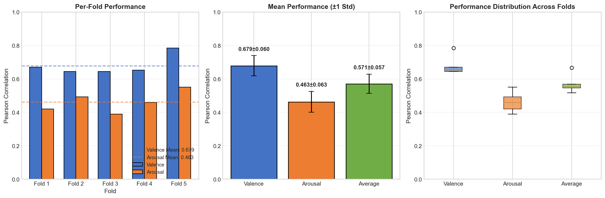
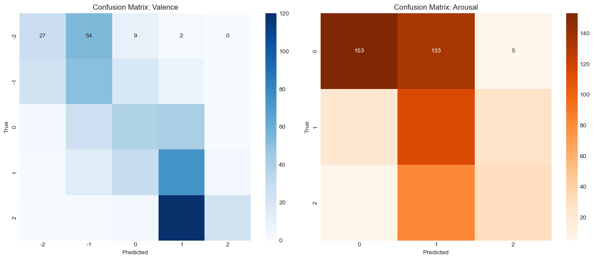
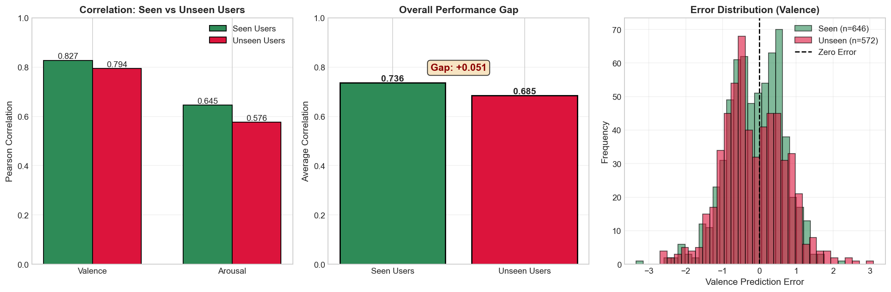
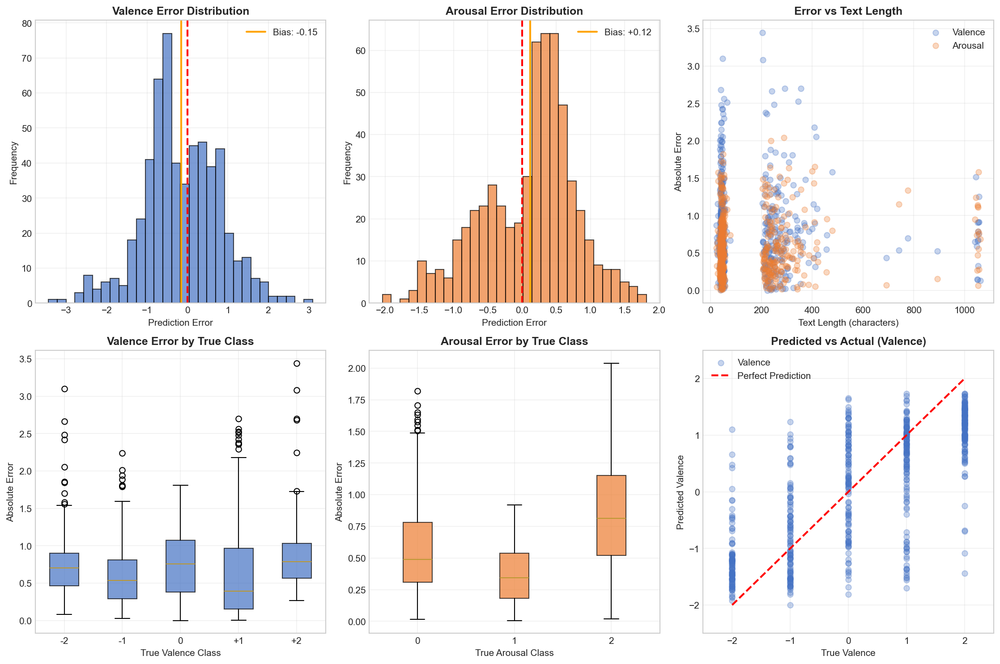
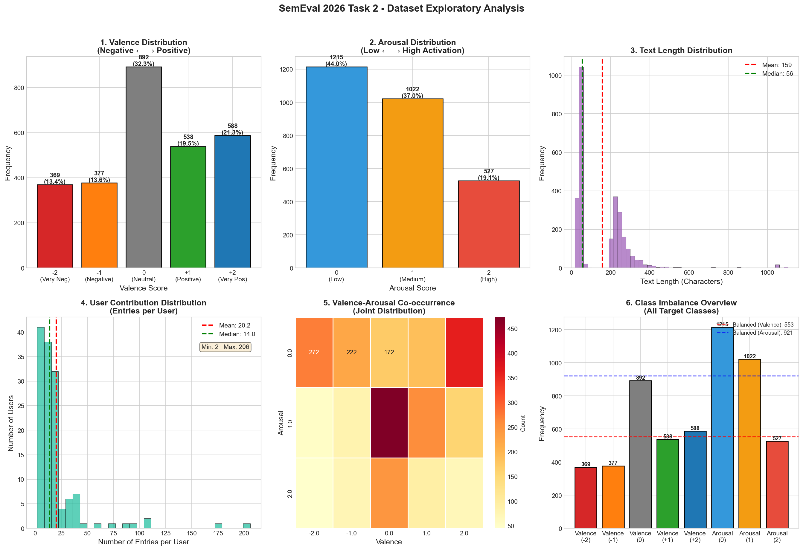

# Valence & Arousal Prediction from Ecological Essays

Predicting how positive (valence) and how activated (arousal) people feel from short texts they wrote repeatedly over time, using a fine-tuned DistilBERT encoder and an LSTM over each user's text history (SemEval-2026 Task 2, Subtask 1).

## Highlights

- Evaluated on the **official SemEval-2026 test set** (1,737 texts from 91 users, scored against the gold labels released by the organizers) with the task's composite within/between-person correlation: **0.666 for valence and 0.444 for arousal**
- Fine-tuned **DistilBERT** regression baseline with an **inverse-frequency weighted loss** to counter strong label imbalance
- **LSTM sequence model** over each user's chronologically ordered texts, with the previous entry's valence/arousal as an extra input. It beats the baseline on the test set (valence 0.666 vs. 0.644, arousal 0.444 vs. 0.434).
- **User-based** train/validation splits and **5-fold cross-validation**, so no author appears in both training and validation
- Ablation study (user embeddings vs. history), a **domain-adversarial (DANN)** variant, error analysis, and seen vs. new user comparisons

## Overview

Each user in the dataset wrote many short entries over time and self-reported their valence (−2 to +2) and arousal (0 to 2) for each one. The goal is to predict both scores from the text. Because entries come in per-user sequences, the project compares a text-only model with sequence models that also see the user's recent emotional history. It also checks how well each one generalizes to authors it has never seen.

## Dataset

- **Source:** [SemEval-2026 Task 2](https://github.com/semeval2026task2/EmotionValArouTimeVariation2026) (Predicting Variation in Emotional Valence and Arousal over Time from Ecological Essays), Subtask 1
- **Training data** (`train_subtask1.csv`): 2,764 texts from 137 users, between 2 and 206 entries per user. 51.8% are lists of feeling words and 48.2% are short essays.
- **Test data** (`test_subtask1.csv` + `test_labels_subtask1.csv`): 1,737 texts from 91 users. 46 of these users also appear in the training data and 45 are new.
- **Labels:** valence in {−2, −1, 0, +1, +2} and arousal in {0, 1, 2}. Both are imbalanced: in the training data, neutral valence is 32.3% of the samples, low arousal 44.0% and high arousal only 19.1%.
- **License:** the task repository is released under CC0-1.0. The data is not included here; see [How to run](#how-to-run).
- **Task paper:** Soni et al., [SemEval-2026 Task 2](https://aclanthology.org/2026.semeval-1.451/), SemEval 2026

## Approach


1. **EDA:** label distributions, text lengths, per-user activity and valence–arousal co-occurrence.
2. **Baseline:** `distilbert-base-uncased` with dropout and a linear head on the [CLS] token. It predicts both targets jointly and is trained with an inverse-frequency weighted MSE loss (AdamW, lr 2e-5, 5 epochs) on a user-based 80/20 split.
3. **Cross-validation:** user-based 5-fold CV of the baseline (3 epochs per fold).
4. **Sequence model:** the fine-tuned DistilBERT is frozen and used as a feature extractor. An LSTM reads each user's sequence of [CLS] embeddings together with the previous entry's valence/arousal and is trained with a weighted Smooth L1 loss and early stopping.
5. **Ablations and DANN:** retraining without user embeddings or without the history input, and a domain-adversarial variant with a gradient reversal layer and a user-identity classifier.
6. **Validation analysis:** Pearson correlation, macro precision/recall/F1 after rounding to classes, confusion matrices, error analysis, and a comparison of seen vs. unseen users.
7. **Inference:** autoregressive prediction per user, where each prediction is fed back as the history input for the next entry.
8. **Test-set evaluation** (`evaluate_test_set.py`): the saved models predict the official test set (the sequence model autoregressively), and the predictions are scored with the task's official metric, both overall and for seen vs. new users.

## Results

### Official test set

The test texts and their gold labels were never used for training or model selection. The metric is the task's official **composite correlation**, the Fisher-z average of two components:
- **Within-person r:** how well each user's ups and downs are tracked
- **Between-person r:** how well differences between users are captured

The table also shows the flat Pearson r over all texts, which is the metric used during validation.

| Model | Valence (composite r) | Arousal (composite r) | Valence (Pearson r) | Arousal (Pearson r) |
|---|---|---|---|---|
| DistilBERT baseline | 0.644 | 0.434 | 0.664 | **0.537** |
| **LSTM + history (final)** | **0.666** | **0.444** | **0.678** | 0.527 |

Composite r by user group. "Seen" follows the official flag: 37 of the 46 seen users were in this project's training split and 9 in its validation split.

| Users | Texts | Baseline valence | Baseline arousal | Final valence | Final arousal |
|---|---|---|---|---|---|
| Seen in the training data (46) | 692 | 0.664 | 0.333 | **0.687** | **0.350** |
| New users (45) | 1,045 | 0.628 | **0.580** | **0.645** | 0.548 |
| All (91) | 1,737 | 0.644 | 0.434 | **0.666** | **0.444** |

- The final model beats the baseline overall, and the gain comes from **between-person** correlation (valence 0.691 → 0.732). Within-person correlation is essentially unchanged (0.591 vs. 0.587).
- **Validation overstated real performance.** For the final model, Pearson r dropped from 0.794 to 0.678 (valence) and from 0.576 to 0.527 (arousal).
- **Teacher forcing explains only part of that drop.** If the model were given the gold previous labels as history, which are not available in practice, it would reach Pearson r of 0.695 / 0.547 (composite 0.690 / 0.481). The rest reflects the difference between the 28 validation users and the test population.
- **Arousal is much harder on new texts from seen users (0.350) than on new users (0.548).** On new users, the baseline is slightly better for arousal.

### Validation experiments

Pearson correlation on the validation set (572 texts from 28 users not used for training):

| Model | Valence r | Arousal r | Average r |
|---|---|---|---|
| DistilBERT baseline (weighted MSE) | 0.7797 | 0.5630 | 0.6714 |
| DistilBERT baseline, 5-fold user-based CV (mean ± std) | 0.6791 ± 0.0599 | 0.4626 ± 0.0626 | 0.5708 ± 0.0572 |
| **LSTM + history, no user embeddings (final)** | **0.7943** | **0.5763** | **0.6853** |
| Ablation: text + history (no user embeddings) | – | – | 0.6829 |
| Ablation: text + user embeddings (no history) | – | – | 0.6762 |
| DANN (gradient reversal on user identity) | – | – | 0.6847 |

Classification metrics for the final model, with predictions rounded to the nearest class:

| Metric | Valence | Arousal |
|---|---|---|
| Macro precision | 0.4754 | 0.5607 |
| Macro recall | 0.3823 | 0.4952 |
| Macro F1 | 0.3624 | 0.4832 |

These validation scores are optimistic for two reasons:
- The same 28 users were used to select checkpoints.
- The sequence models received the ground-truth previous labels as history (teacher forcing).

The test-set results above are the reliable estimate.











## Key findings

- **The history model helps, but less than validation suggested:** on the official test set it beats the baseline (composite r 0.666 vs. 0.644 for valence), while validation scores were 0.05–0.12 higher than test scores.
- **Valence is easier than arousal:** valence correlation is well above arousal correlation in every experiment (0.666 vs. 0.444 composite r on the test set), consistent with arousal being the more subjective dimension.
- **History matters more than user identity:** in the ablation, removing the previous valence/arousal input lowered the average correlation more (0.6762) than removing user embeddings (0.6829). The final model therefore keeps the history and drops the user embeddings.
- **Extreme emotions are the hardest:** on the validation users, very positive valence (+2) has a recall of 0.15 and high arousal a recall of 0.25. Predictions regress toward the middle of the scale, which explains why valence correlation is high (0.79) while macro F1 is low (0.36).

## Tech stack

Python, PyTorch, Hugging Face Transformers (DistilBERT), scikit-learn, SciPy, pandas, NumPy, Matplotlib, seaborn, Jupyter

## Project structure

```
semeval-2026-emotion-prediction/
├── semeval_2026_emotion_prediction.ipynb   # training and analysis: EDA, models, validation, inference
├── evaluate_test_set.py                    # evaluation on the official test set
├── results/
│   └── test_set_results.json               # test-set metrics (all / seen / new users)
├── figures/                                # figures used in this README
├── requirements.txt
└── README.md
```

## How to run

```bash
git clone https://github.com/efe-akpinar/semeval-2026-emotion-prediction.git
cd semeval-2026-emotion-prediction

python -m venv .venv
source .venv/bin/activate
pip install -r requirements.txt jupyter

# Training data (official task repository)
DATA=https://raw.githubusercontent.com/semeval2026task2/EmotionValArouTimeVariation2026/main/datasets
curl -L -o train_subtask1.csv $DATA/TRAIN_RELEASE_3SEP2025/train_subtask1.csv

jupyter notebook semeval_2026_emotion_prediction.ipynb
```

Run the cells in order. The baseline cell saves `best_baseline_model.bin`, which the sequence model, ablation, DANN and evaluation cells load as their feature extractor. The sequence model cell saves `best_sequence_model.bin`, which the later evaluation and inference cells use. A GPU is recommended for fine-tuning DistilBERT, but the code falls back to CPU.

To evaluate the trained models on the official test set:

```bash
# Test texts and gold labels (kept in data/, because the notebook writes a mock test_subtask1.csv to the working directory)
mkdir -p data
curl -L -o data/test_subtask1.csv $DATA/TEST_RELEASE_5JAN2026/test_subtask1.csv
curl -L -o data/test_labels_subtask1.csv $DATA/TEST_LABELS_RELEASE_23FEB2026/test_labels_subtask1.csv

python evaluate_test_set.py --test-csv data/test_subtask1.csv --labels-csv data/test_labels_subtask1.csv
```

This writes `results/test_set_results.json` and `results/test_predictions.csv`.

---

Built as a team project (team of 4).
